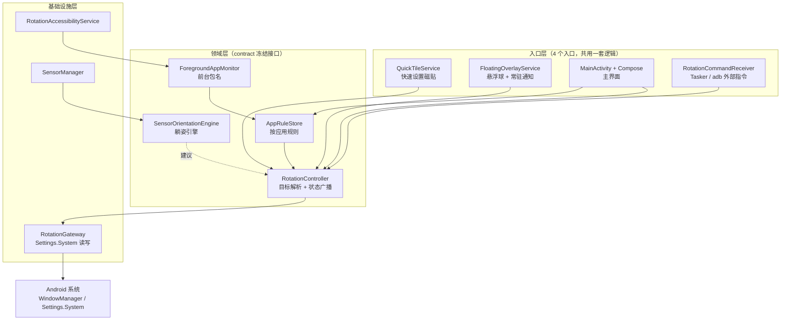

# 屏幕方向控制 LazyRotate —— 安卓平板屏幕方向控制 App 需求与技术方案

| 项目 | 内容 |
|---|---|
| 文档版本 | v1.0 |
| 目标平台 | Android 7.0（API 24）及以上，重点适配 **平板/大屏** |
| 交付形态 | 可安装 APK + 完整 Kotlin/Compose 源码工程 + 构建脚本 + 本文档 |
| 应用包名 | `com.lazyrotate.app` |
| 应用名称 | 屏幕方向控制（LazyRotate） |
| 一句话定位 | 把「屏幕朝哪边」这件事从传感器的猜测，变回用户的决定 |

---

## 0. 结论先行（给赶时间的人）

1. **系统自动旋转在躺姿下不好用，不是你的错觉，是原理决定的。** 系统的自动旋转只靠重力矢量判断倾斜方向；当你半躺、仰躺把平板举在面前时，屏幕平面接近水平，重力在屏幕平面上的投影趋近于零，系统**没有足够信息判断方向**，于是表现为「不转」或「来回乱转」。任何纯算法改进都无法在信息量不足时凭空判断，唯一的可靠解法是**让用户直接指定方向**。
2. **免 root 也能做到全局强制方向**，手段是：关闭自动旋转（`ACCELEROMETER_ROTATION=0`）后写入系统设置 `USER_ROTATION`（0/1/2/3）。这需要用户手动授予一个特殊权限 `WRITE_SETTINGS`，一次授权长期有效。
3. **免 root 的天花板很清楚**：对「自己在代码里写死了方向」的应用（大量视频、游戏、部分国内 App）无效。突破它有两条路：① 在 Android 16+ 大屏上，这类限制已被系统放开；② 由用户在**电脑上执行一次 shell 命令**：
   - `adb shell cmd window set-ignore-orientation-request true`（全局忽略应用的方向请求，**重启后仍保留**）
   - `adb shell cmd window fixed-to-user-rotation enabled`（更彻底：系统无条件采用你设定的方向，代价是固定方向的应用会出现黑边）

   **注意：这条路 App 自己走不通。** 该开关由系统 `WindowManagerService` 持有，实现是隐藏 AIDL 接口 `IWindowManager.setIgnoreOrientationRequest()`，状态落在 `/data/system/display_settings.xml`（**不是** `Settings.Global` 数据库），并且只对 shell 身份开放。授予 `WRITE_SECURE_SETTINGS` 也**不够**。因此本 App 在这件事上只能做「引导 + 生成可复制命令」——这一点在实现中已按"诚实优先"处理：**不提供点了没反应的假开关**。
4. **Android 16 起情况明显好转**：以 API 36 为目标的应用，在小宽度 ≥ 600dp 的大屏上会被系统**忽略自身声明方向与不可调整尺寸的限制**。也就是说，过去那些「锁死竖屏」的应用在大屏上将被放开，本项目所依赖的「系统级强制方向」才真正普遍生效。这也是我们把 `targetSdk` 定在 36 的原因。
5. 本 App 的设计核心不是「再多一个旋转开关」，而是三件系统没做好的事：**一键锁定当前方向**、**一键翻转 180°**（侧躺换边必备）、**不确定就不动**的保守策略（消除来回乱转）。同时提供磁贴 / 悬浮球 / 通知三个入口，因为躺着的时候人不想回桌面。

---

## 1. 需求来源与场景分析

### 1.1 用户画像

| 画像 | 场景 | 关键诉求 |
|---|---|---|
| **躺姿视频党**（主要用户） | 躺在床上侧躺/仰躺看视频、刷 B 站、看漫画 | 方向要稳、要能一键翻 180° |
| 半躺阅读者 | 靠在床头看 PDF/网页 | 锁定横屏不被打断 |
| 支架/桌面用户 | 平板架在桌上当副屏 | 锁定某个固定方向，不要被误触发 |
| 床头游戏玩家 | 侧躺玩横屏游戏 | 游戏锁死方向时也想能反过来 |
| 开发者/自动化玩家 | 用 Tasker 等自动化控制 | 需要可被外部调用的接口 |

### 1.2 痛点拆解（这是本项目存在的理由）

按「根因 → 现象 → 我们的对策」逐条拆：

**痛点 1：躺姿下系统判断方向的信息量不足**
- 现象：躺着看横屏视频，稍微动一下平板就转成竖屏；或者明明横着拿却不转，要晃两下才转。
- 根因：系统自动旋转依据的是重力矢量在设备屏幕平面上的投影方向。当屏幕平面接近水平（仰躺举着平板）时，投影长度趋近 0，信噪比极低，方向判断本质上是**猜**。
- 对策：① 提供「锁定当前方向」——用户指哪打哪，不依赖传感器；② 自研躺姿引擎，在置信度不足时**明确输出「不改变」**，而不是硬猜。

**痛点 2：换一边侧躺，横屏方向就反了**
- 现象：向左侧躺时横屏是正的，翻个身向右侧躺，画面倒过来了（或反过来）。
- 根因：横屏有两个相差 180° 的解，重力矢量本身可以区分它们，但用户的直觉是「我人没动，画面不该动」；而系统的旋转锁定只锁「横屏/竖屏」这一维度，不是锁一个绝对角度。
- **更深一层的根因（已核实到源码）**：系统的方向监听器**默认拒绝 180° 倒置**——除非应用主动请求 `SCREEN_ORIENTATION_FULL_SENSOR` / `FULL_USER`，否则"上下颠倒"这个方向根本不会被系统采纳。也就是说，躺姿换边后画面倒过来这件事，**系统按设计就不打算帮你修**。这恰恰是本项目「翻转 180°」按钮存在的根本理由。
- 对策：把「翻转 180°」提升为与「锁定」同等重要的**一级按钮**，一键把画面翻过来。

**痛点 3：没有记忆，轻微抖动就触发**
- 现象：手抖、呼吸起伏导致画面来回翻。
- 根因：系统的方向切换阈值偏向灵敏，缺少「必须稳定持续一段时间才切换」的迟滞机制，也没有「设备正在移动就不切换」的门控。
- 对策：躺姿引擎加入**迟滞（dwell）+ 静止判定 + 置信度闸门**三重过滤。

**痛点 4：应用自己写死了方向，系统锁定对它无效**
- 现象：「我明明关了自动旋转，这个 App 还是自己转」或「我想让它横过来，它就是不动」。
- 根因：应用可以在清单里声明 `android:screenOrientation`，或运行时调用 `setRequestedOrientation()`。**第三方普通应用无权覆盖另一个应用的方向请求**——这是 Android 的架构级隔离，不是权限不够。
- 对策：① 明确告知用户这是免 root 的边界（不要让用户以为是 Bug）；② 提供 `IgnoreOrientationRequest` 高级档（ADB 一次性授权），让系统忽略应用自己的方向请求；③ 在 Android 16+ 大屏上，这类限制本身就被系统放开了。

**痛点 5：厂商定制让「旋转锁定」的位置和行为都不一样**
- 现象：换一台平板就要重新找一遍设置；有的机型旋转锁定还会被某些应用的兼容模式绕过。
- 根因：`Settings.System` 是标准接口，但各家 ROM 的 UI 入口、默认值、附加策略（如某些 ROM 的「智能旋转」「人脸感知旋转」）各不相同。
- 对策：把控制权收敛到我们自己的磁贴/悬浮球上，用户不需要去记各家 ROM 的设置路径。

### 1.3 需求清单

优先级定义：**P0 = 没有它就不成立；P1 = 显著提升体验；P2 = 增强/进阶**。

#### 功能性需求

| 编号 | 需求 | 说明 | 优先级 |
|---|---|---|---|
| FR-1 | 锁定当前方向 | 一键把当前屏幕方向固定下来，此后不随传感器变化 | **P0** |
| FR-2 | 翻转 180° | 在当前方向基础上翻转 180°，侧躺换边必备 | **P0** |
| FR-3 | 恢复跟随系统 | 重新打开自动旋转，交还控制权 | **P0** |
| FR-4 | 绝对方向锁定 | 0°/90°/180°/270° 四个绝对角度，以及「横屏/竖屏/反向横屏/反向竖屏」语义化选项 | **P0** |
| FR-5 | 快速设置磁贴 | 从通知栏下拉一键操作，不用回桌面 | **P0** |
| FR-6 | 权限引导 | 首次进入引导授予 `WRITE_SETTINGS`，并在缺失时给出可点击的引导而非静默失败 | **P0** |
| FR-7 | 状态可视化 | 明确显示「当前是否锁定、锁在哪个方向」，避免用户靠猜 | **P0** |
| FR-8 | 常驻通知快捷操作 | 通知栏内直接锁定/翻转/恢复 | **P1** |
| FR-9 | 悬浮球 | 不离开当前应用即可操作；支持拖动、位置记忆、单击/双击/长按 | **P1** |
| FR-10 | 按应用规则 | 为指定应用设置固定方向，切换前台应用时自动套用 | **P1** |
| FR-11 | 躺姿方向引擎 | 自研置信度闸门 + 迟滞的方向判断，不确定就不动 | **P1** |
| FR-12 | 开机恢复 | 重启后恢复上次的锁定状态（可关闭） | **P1** |
| FR-13 | 外部指令接口 | `ACTION_SET_ROTATION` / `ACTION_CYCLE` / `ACTION_FLIP`，供 Tasker、快捷方式、`adb am start` 调用 | **P1** |
| FR-14 | 高级档：系统级方向强制（**引导式**） | 该能力 App 自身无法完成（隐藏 AIDL 接口 + 仅 shell 身份可用）。App 负责：检测 `WRITE_SECURE_SETTINGS` 状态、生成并复制可直接粘贴的 shell 命令、如实说明每条命令的边界与代价。**不得实现为可切换的开关** | **P2** |
| FR-15 | 桌面模式/自由窗口预设 | 多窗口、桌面模式下快速切换横竖屏 | **P2** |
| FR-16 | Shizuku 集成 | 免 ADB 线的高级档授权路径 | **P2** |

#### 非功能性需求

| 编号 | 需求 | 指标 |
|---|---|---|
| NFR-1 | 隐私 | **不申请 `INTERNET` 权限**；不采集、不上传任何数据；所有配置仅存本机；关闭云备份 |
| NFR-2 | 权限最小化 | 不申请 `QUERY_ALL_PACKAGES`（用 `<queries>` 精确放开启动器应用）；无障碍服务只读取前台包名，声明 `canRetrieveWindowContent=false` |
| NFR-3 | 性能 | 冷启动 < 1s；常驻内存 < 80MB；悬浮球常驻 CPU < 1%；无 `WakeLock` |
| NFR-4 | 躺姿可用性 | 主操作按钮 ≥ 120dp，单手拇指可达；核心操作 ≤ 1 次点击 |
| NFR-5 | 健壮性 | 任何权限缺失、前台包名为 null、规则为空时界面均可用，**不崩溃、不死循环拉起设置页** |
| NFR-6 | 幂等性 | 所有写系统设置的操作可重复执行，无权限时返回失败而不是抛异常 |
| NFR-7 | 兼容性 | Android 7.0 ~ Android 17；自然横屏与自然竖屏设备都能正确解释「横屏/竖屏」 |
| NFR-8 | 可构建性 | 工程可用 Android Studio 直接打开并构建；构建产出的 APK 已在本机验证 |

### 1.4 明确不做（范围边界）

- 不做任何依赖 root 的功能（仅在文档中说明可行性）。
- 不做 Hook / Xposed / 修改其它应用进程的行为。
- 不做屏幕录制、投屏、虚拟显示。
- 不做「自动学习用户习惯」的黑箱推荐旋转——躺姿场景下可预测性比聪明更重要。
- 不申请网络权限，因此不提供云同步、账号、统计。

---

## 2. 技术可行性分析

### 2.1 免 root 到底能做到什么

**核心机制**：Android 的屏幕方向最终由系统 `WindowManager` 依据两个系统设置决定：

| 设置键 | 含义 | 取值 |
|---|---|---|
| `Settings.System.ACCELEROMETER_ROTATION` | 是否启用自动旋转（重力感应） | `1` 开 / `0` 关 |
| `Settings.System.USER_ROTATION` | 关闭自动旋转时使用的屏幕旋转角度 | `0` / `1` / `2` / `3` 对应 0°/90°/180°/270° |

因此「免 root 强制方向」的完整动作是两步：**先把 `ACCELEROMETER_ROTATION` 写 0（关闭自动旋转），再把 `USER_ROTATION` 写成目标角度**。这两步都只需要 `android.permission.WRITE_SETTINGS`——这是一个「特殊权限」，不属于运行时权限对话框，必须通过 `Settings.ACTION_MANAGE_WRITE_SETTINGS` 跳转到系统页面由用户手动打开，授权一次长期有效（`Settings.System.canWrite(context)` 可查询）。

> **实现要点（已在代码中落实）**：写入时不要只写 `USER_ROTATION`。如果自动旋转还开着，系统会继续使用传感器，`USER_ROTATION` 会被忽略，表现为「点了没反应」——这正是很多同类应用被差评的原因。

**这一机制的适用面**：对所有「没有自己声明固定方向」的可旋转 Activity 生效，覆盖范围很广（浏览器、系统设置、文件管理、多数阅读类应用等）。

### 2.2 为什么不能直接改别的应用的方向

Android 的窗口方向由每个 Activity 通过 `Activity.setRequestedOrientation()` 或清单中的 `android:screenOrientation` 向系统声明，最终由 `WindowManager` 仲裁。第三方应用进程之间没有互相修改窗口属性的通道，这属于架构级隔离：

- `WRITE_SETTINGS` 只能改系统设置，不能改别的应用的窗口请求；
- `SYSTEM_ALERT_WINDOW`（悬浮窗）只能在自己窗口上叠加内容，不能改变宿主应用的窗口方向；
- `AccessibilityService`（无障碍）**无法**设置其它应用的方向，它的能力是读取界面事件、执行点击/手势，方向控制不在其能力集内。

**结论**：免 root 方案一定存在「对硬编码方向的应用无效」这个缺口。把它诚实地写进产品说明，比假装能做到更能减少差评。

### 2.3 各 Android 版本的关键差异

| 版本 | 与本项目相关的关键行为 | 对本项目的影响 |
|---|---|---|
| 7.0 – 8.1（API 24–27） | `WRITE_SETTINGS` 机制已存在；快速设置磁贴 API 24 起可用；悬浮窗用 `TYPE_PHONE` | 兼容基线 |
| 9（API 28） | 悬浮窗类型改为 `TYPE_APPLICATION_OVERLAY` | 需按版本分支选窗口类型 |
| 10（API 29） | 后台启动 Activity 受限 | 悬浮球点击后打开主界面需谨慎处理 |
| 11（API 30） | 包可见性收紧（Package Visibility） | 枚举已装应用需 `<queries>` 声明 |
| 12（API 31） | 前台服务启动限制；`PendingIntent` 必须声明可变性 | 通知 action 用 `FLAG_IMMUTABLE` |
| 12L（API 32） | 引入大屏「忽略应用方向请求」的开发选项（`IgnoreOrientationRequest`） | 高级档绕过硬编码方向的依据 |
| 13（API 33） | `POST_NOTIFICATIONS` 变为运行时权限 | 通知需申请权限，缺失时功能降级 |
| 14（API 34） | 前台服务必须声明类型；磁贴 `startActivityAndCollapse` 改用 `PendingIntent` 重载 | 悬浮球前台服务用 `specialUse`；磁贴需分支处理 |
| 15（API 35） | 后台启动前台服务进一步收紧 | 悬浮球只能由前台用户操作启动 |
| **16（API 36）** | **以 36 为目标的应用，在小宽度 ≥ 600dp 的大屏上，系统忽略其方向、可调整尺寸与宽高比限制** | **重大利好：大量「锁死方向」的应用在大屏上被放开，本项目的强制方向才普遍生效** |
| 17（API 37） | 平台采用 minor SDK 版本机制，稳定平台包名为 `platforms/android-37.0`（落盘目录名带点） | 构建侧注意：最新稳定版 AndroidX 的 AAR metadata 强制要求 `compileSdk ≥ 37`；本工程用 `compileSdk = 37` + `targetSdk = 36`（AGP 9.4.1 能正确识别带点的 `android-37.0` 目录，实测已出包） |

> **关于 `targetSdk = 36` 的取舍**：`targetSdk` 决定了「大屏忽略方向限制」这条变更是否生效。定在 36 意味着在 Android 16/17 设备上，本项目控制的 App 池子最大。副作用是需要额外处理 Android 15/16 的前台服务与后台限制，这些已在实现中处理。

### 2.4 能力分级（T0 → T3）

| 层级 | 需要什么 | 能做什么 | 不能做什么 | 本项目状态 |
|---|---|---|---|---|
| **T0 免 root** | `WRITE_SETTINGS`（用户手动授权一次） | 全局强制方向、锁定/翻转、磁贴/悬浮球/通知、按应用规则（基于前台包名）、躺姿引擎 | 无法覆盖应用自己写死的方向 | ✅ 已实现（主路径） |
| **T1 无障碍** | 无障碍服务开关 | 读取**前台应用包名**（仅包名）→ 驱动按应用规则自动切换 | 仍然不能修改其它应用的方向声明 | ✅ 已实现（可选开启） |
| **T2 shell 命令（电脑执行一次）** | 电脑执行：`adb shell cmd window set-ignore-orientation-request true`（查询 `get-ignore-orientation-request`，关闭用 `false`）；或更彻底的 `adb shell cmd window fixed-to-user-rotation enabled` | 让系统忽略应用自身声明的方向；后者无条件采用 `USER_ROTATION`，连硬编码方向的应用也能强制旋转 | **App 无法自己完成**（隐藏 AIDL 接口，只对 shell 身份开放；状态在 `/data/system/display_settings.xml`，不是 `Settings.Global`）；`fixed-to-user-rotation` 会让被强制应用出现黑边 | ✅ 已实现为"引导 + 命令复制"（诚实实现，见下） |
| **T2-b `WRITE_SECURE_SETTINGS`** | `adb shell pm grant com.lazyrotate.app android.permission.WRITE_SECURE_SETTINGS` | 能力探针（`hasSecureSettings()`）；为将来 Shizuku 实现预留统一入口 | **仅凭该权限并不能打开 T2 的开关**。我们曾尝试写 `Settings.Global` 的 `"ignore_orientation_request"` 键——经源码核实该键**根本不存在**（`Settings.java` 全文零命中），WindowManagerService 不读它，写了也不生效 | ✅ 已实现（探针 + 诚实降级：`setIgnoreOrientationRequest()` 恒返回 false） |
| **T2-c 按应用（待复核）** | `adb shell am compat enable OVERRIDE_ENABLE_COMPAT_IGNORE_REQUESTED_ORIENTATION <包名>`（取消用 `am compat disable`） | 只对指定应用放开方向 | 来源是官方"大屏兼容模式"文档，但**尚未独立复核原文**；`am compat` 需 shell 身份、按包持久化、执行后默认会重启目标应用 | 📋 仅在 UI 里作为可选命令列出，并如实标注"请自行确认" |
| **T3 root / Shizuku** | root 或 Shizuku 服务 | 更彻底的注入与逐应用覆盖 | 门槛高、风险高 | ⛔ 仅文档说明，未实现 |

### 2.5 躺姿方向引擎（本项目的技术差异化）

系统的 `WindowOrientationListener` 只能拿重力做判断。我们要做的不是「更聪明地猜」，而是**知道自己什么时候不知道**：

```
每个传感器样本（TYPE_GRAVITY，缺失时退回 TYPE_ACCELEROMETER）：
    g = (gx, gy, gz)                      # 设备坐标系下的重力
    inPlane = sqrt(gx² + gy²)             # 重力在屏幕平面上的投影长度
    conf = inPlane / |g|                  # 0..1，置信度

    if conf < 0.25:
        候选方向 = null                    # ← 关键：明确输出「不改变」
    else:
        候选方向 = 由 (gx, gy) 的符号与 atan2 落到最近的四个方向之一

    迟滞：候选方向必须连续保持 DWELL ≈ 700ms，且期间加速度方差 < 运动阈值，才真正切换
    运动门控：设备明显处于移动状态时不切换
    平放补充：conf 很低且设备接近水平时，可尝试用 TYPE_ROTATION_VECTOR / 磁力计的偏航角
              推断屏幕平面内的朝向；若磁力计不可用或精度等级低，仍然输出 null
    优先级：用户的手动锁定/翻转 > 引擎建议（引擎只建议，不覆盖用户的显式选择）
```

**为什么「不确定就不动」是正确的设计**：躺姿下系统的乱转本身就是信息不足导致的错误决策；保持现状虽然可能不够及时，但它是稳定、可预测、用户可手动纠正的。这与「更灵敏地自动旋转」是相反的取舍，也正是本产品的立场。

**系统在这件事上究竟做了什么（已核实到源码，它解释了为什么"更灵敏"是错的方向）**：

| 系统的机制 | 具体表现 | 对用户的后果 |
|---|---|---|
| 接近水平时**主动放弃**判定（`MAX_TILT = 80`、`FLAT_ANGLE = 80`；AOSP 注释明写 "orientation angle is not meaningful when the device is nearly horizontal"） | 屏幕接近水平时不产生方向变化 | 仰躺举着平板时"怎么晃都不转" |
| `isFlat` / `isSwinging` / `isAccelerating` **三重抑制**，每项都要求 300–500ms 静默 | 手在动、床面软、设备晃动时一律不判定 | 躺姿下几乎一直处于被抑制状态 |
| **默认拒绝 180° 倒置**（除非应用请求 `FULL_SENSOR` / `FULL_USER`） | "上下颠倒"这个方向永远不被采纳 | 换边后画面倒过来，系统不管 |
| **45° 迟滞死区** | 接近判定边界时来回跳 | "边缘来回翻转" |
| 软支撑面（床垫、被子）使 `isFlat` 反复进出 | 判定状态抖动 | 不稳定、不可预测 |

**结论**：这五条里有四条是系统**刻意**的设计（目的是避免误判），不是算法缺陷。所以"做一个更聪明的自动旋转"这条路收益上限很低；**正确的产品方向是把决定权交回用户**——这正是本项目把「锁定当前方向」和「翻转 180°」放在首屏的原因，也是我们把躺姿引擎定位为"只在信息足够时才动、不够时明确不动"的原因。

---

### 2.6 三条「系统级强制方向」的隐藏路径对比

这三条路径不是用来替代 `USER_ROTATION` 的，而是用来**让系统愿意采纳 `USER_ROTATION`**——即把"应用自己声明了固定方向"这个障碍移除。

| 路径 | 命令 | 范围 | 机制与表现 | 代价 | 前提 |
|---|---|---|---|---|---|
| 忽略应用的方向请求 | `cmd window set-ignore-orientation-request true`（查询 `get-ignore-orientation-request`） | 全局（可按显示指定） | 把应用的方向请求**丢弃为 `UNSET`**，应用不再被 letterbox、**铺满整屏**，然后跟随系统方向。效果是「**App 被说服了**」 | 依赖应用的 targetSdk/大屏策略配合 | shell 身份；**命令持久，重启后仍保留** |
| 固定为用户方向（更彻底） | `cmd window fixed-to-user-rotation enabled`（取值 `enabled`/`disabled`/`default`/`enabled_if_no_auto_rotation`） | 全局（支持 `-d <displayId>`） | `rotationForOrientation()` 直接 `return mUserRotation`，**无条件**采用用户设定；显示层硬转，但**应用的方向请求仍被尊重用于布局**，因此会留黑边。效果是「**屏幕转了，App 被塞进 letterbox**」 | 被强制的固定方向应用出现黑边 | shell 身份；命令持久；⚠️ **不要用 `enabled_if_no_auto_rotation`**（它只在设备根本不支持自动旋转时生效） |
| 按应用兼容覆盖 | `am compat enable OVERRIDE_ENABLE_COMPAT_IGNORE_REQUESTED_ORIENTATION <包名>` | 单应用 | 同第一行的机制，但只作用于一个应用 | 执行后目标应用会被重启 | shell 身份；**命令本身待独立复核** |

**体验取舍一句话**：前者让 **App 跟着屏幕转、铺满**（体验更好）；后者让 **屏幕硬转、App 留黑边**（最彻底、对所有 App 生效）。

**共同结论**：三者都只对 shell 身份开放，因此**在免 root 前提下第三方应用无法自行完成**。现实中可行的只有三条：① 电脑 ADB 执行一次（命令持久，最省事）；② Shizuku（免电脑，但需要每次重启后启动服务）；③ root。

**这也是本 App 把高级档做成"引导 + 命令复制"而不是开关的原因**——做成开关就是骗用户。

## 3. 产品设计

### 3.1 核心交互：三个入口，一套逻辑

| 入口 | 触发方式 | 作用 | 设计理由 |
|---|---|---|---|
| **快速设置磁贴** | 下拉通知栏点一下 | 循环：跟随系统 → 锁定当前 → 翻转 180° → 跟随系统 | 任何界面下两步可达；不占屏幕空间 |
| **悬浮球** | 单击=循环，双击=翻转，长按=打开主界面，拖动=移动位置（位置记忆） | 躺姿单手操作，不用离开当前应用 | 躺着时通知栏也不好拉 |
| **常驻通知** | 通知栏内的按钮 | 锁定 / 翻转 / 跟随系统 | 悬浮球关掉后的备选 |
| **主界面** | 打开 App | 完整功能 + 权限引导 + 按应用规则 + 设置 | 配置一次，之后几乎不用进 |

三个入口**共用同一个 `RotationController`**，不允许各自实现一套写设置逻辑——否则会出现「磁贴锁了、通知没同步」这类不一致。

### 3.2 主界面结构（平板优先）

```
┌──────────────────────────────────────────────────────────────┐
│ 屏幕方向控制    [已锁定 · 90°]        ← 状态卡：锁没锁、锁在哪 │
├──────────────────────────────────────────────────────────────┤
│                                                              │
│   ┌────────────────────────┐  ┌────────────────────────┐    │
│   │                        │  │                        │    │
│   │      锁定当前方向       │  │       翻转 180°         │    │  ← ≥120dp 大按钮
│   │        🔒              │  │         ⟳              │    │     躺姿单手可点
│   └────────────────────────┘  └────────────────────────┘    │
│                                                              │
│   跟随系统   竖屏   横屏   反向竖屏   反向横屏                │  ← 语义化快捷
│   0°        90°    180°   270°                               │  ← 绝对角度
│                                                              │
│   ┌─ 躺姿引擎 ───────────────────────────────┐               │
│   │ [开]  置信度 ▓▓▓░░ 32%   当前：保持现状   │               │  ← 「保持现状」是正面文案
│   └──────────────────────────────────────────┘               │
│                                                              │
│   ┌─ 当前前台应用 ──────────────────────────┐                │
│   │ Bilibili  (tv.danmaku.bili)   [设为横屏] │                │
│   └──────────────────────────────────────────┘               │
├──────────────────────────────────────────────────────────────┤
│   控制          │  应用规则        │  设置                    │  ← 宽屏用 NavigationRail，窄屏用底栏
└──────────────────────────────────────────────────────────────┘
```

**权限缺失时的关键设计**：如果没有 `WRITE_SETTINGS`，不能出现「按钮点了没反应」——主按钮区域上方会出现醒目的引导条，点击直达系统授权页；授权返回后自动刷新状态（`onResume` 时重新读取）。

### 3.3 按应用规则

- 数据模型：`(包名, 显示名, 目标方向, 是否启用)`
- 触发：无障碍服务收到 `TYPE_WINDOW_STATE_CHANGED` 事件，取 `event.packageName` → 命中启用的规则 → 应用规则方向。
- 降级：无障碍未开启时，规则只是"保存着但不生效"，界面明确标注「需要开启无障碍才能自动生效」，并给出一键跳转。
- 备选实现：`UsageStatsManager` 轮询（需要 `PACKAGE_USAGE_STATS`，AppOps 授权），作为无法使用无障碍时的替代路径（P2）。
- **隐私立场**：只读包名，不读屏幕内容（无障碍配置里 `canRetrieveWindowContent="false"`），不做任何上报（App 没有网络权限，从技术上就无法上报）。

### 3.4 状态机

```
         ┌──────────────── 恢复跟随系统 ────────────────┐
         ↓                                              │
   ┌──────────────┐   锁定当前方向    ┌──────────────────────────┐
   │ FOLLOW_SYSTEM│ ────────────────→ │ LOCKED(angle)            │
   │ 自动旋转=开   │                   │ 自动旋转=关 + USER_ROTATION=angle │
   └──────────────┘ ←──────────────── └──────────────────────────┘
         ↑              翻转 180°              │  ↑
         │         angle = angle ⊕ 180°         │  │
         └──────────────────────────────────────┘  │
                                                   │
                        切换前台应用命中规则 ────────┘（进入 LOCKED(rule)）
```

- 用户手动操作后进入「用户优先」状态；按应用规则只在**应用切换时**套用，避免一边看视频一边被规则抢走控制权。
- 所有状态变更都通过 `StateFlow<RotationStatus>` 广播，磁贴/通知/悬浮球/主界面同时对齐。

---

## 4. 技术方案

### 4.1 架构分层



### 4.2 关键设计决策

| 决策 | 选择 | 理由 |
|---|---|---|
| 强制方向的底层手段 | 写 `Settings.System` 两个键 | 免 root 唯一可靠的全局手段 |
| 不引入 DI 框架 | 手写 `ServiceLocator` 组合根 | 应用规模小，少一层依赖少一类故障 |
| 状态共享 | `StateFlow` + `ContentObserver` | 系统设置可能被别处改动，必须回读真实值 |
| 规则持久化 | DataStore Preferences | 不需要 Room；规则量级小 |
| 界面 | Jetpack Compose + Material 3 | 平板自适应布局更容易；无 View 体系包袱 |
| 传感器引擎定位 | 只建议、不强制，且允许输出「不改变」 | 躺姿场景下稳定性 > 灵敏度 |
| 无障碍的必要性 | 可选，仅用于按应用规则 | 高敏权限，能不依赖就不依赖主流程 |

### 4.3 权限清单与授权路径

| 权限 | 类型 | 用途 | 授权路径 | 缺失时的表现 |
|---|---|---|---|---|
| `WRITE_SETTINGS` | 特殊权限 | 写 `ACCELEROMETER_ROTATION` / `USER_ROTATION` | 跳 `ACTION_MANAGE_WRITE_SETTINGS` | **核心功能不可用**，界面醒目标注并引导 |
| `SYSTEM_ALERT_WINDOW` | 特殊权限 | 悬浮球 | 跳 `ACTION_MANAGE_OVERLAY_PERMISSION` | 悬浮球不可用，其余正常 |
| `POST_NOTIFICATIONS` | 运行时（33+） | 常驻通知快捷操作 | 运行时申请 | 通知不可用，磁贴/主界面正常 |
| 无障碍服务 | 系统服务开关 | 读取前台包名 | 跳 `ACTION_ACCESSIBILITY_SETTINGS` | 按应用规则不自动生效，其余正常 |
| `WRITE_SECURE_SETTINGS` | 签名级（ADB） | 仅作能力探针；为将来 Shizuku 实现预留 | `adb shell pm grant ...` | 高级档引导卡片显示"未授予" |
| `RECEIVE_BOOT_COMPLETED` | 普通 | 开机恢复 | 自动 | 开机不恢复，其余正常 |
| `PACKAGE_USAGE_STATS` | AppOps | 前台应用备选实现 | 跳 `ACTION_USAGE_ACCESS_SETTINGS` | 走无障碍路径 |

**没有申请的权限**（有意为之）：`INTERNET`（无法联网，隐私可验证）、`QUERY_ALL_PACKAGES`（用 `<queries>` 精确放开）、任何位置/存储/通讯录权限。

### 4.4 兼容性与降级策略

| 场景 | 处理 |
|---|---|
| API < 26 的悬浮窗 | 用 `TYPE_PHONE`，26+ 用 `TYPE_APPLICATION_OVERLAY` |
| API < 33 的通知权限 | 视为已授予 |
| API 34+ 磁贴打开界面 | 使用 `startActivityAndCollapse(PendingIntent)` 重载 |
| API 34+ 前台服务 | 声明 `specialUse` 类型 + subtype 说明 |
| 后台启动前台服务被拒（Android 12+） | 只允许从主界面/磁贴等前台操作启动，失败时提示而不重试 |
| 自然竖屏平板 | 「横屏/竖屏」语义按 `naturalOrientationIsLandscape` 映射，支持用户在设置中手动覆盖 |
| 无障碍服务被系统杀掉 | 界面状态自动回落，规则暂不生效，不崩溃、不反复弹设置页 |

### 4.5 构建与工具链（本机实测）

| 组件 | 版本 |
|---|---|
| JDK | 17.0.12 |
| Gradle | 9.8.1（wrapper） |
| Android Gradle Plugin | 9.4.1 |
| Kotlin | 2.4.21 |
| Compose BOM | 2026.09.00 |
| compileSdk / targetSdk / minSdk | 37 / 36 / 24 |
| build-tools | 37.0.0 |

**环境说明（重要，可复现）**：本机 PowerShell 的 TLS 栈在受控环境下不可用（`schannel: SEC_E_NO_CREDENTIALS`），`Invoke-WebRequest` / `curl` 均无法建立 HTTPS 连接，但 JDK 的 JSSE 正常。因此本项目的 SDK 自举与依赖下载全部走 Java 侧完成：

- `tools/setup-android-sdk.ps1`：自动解析最新 `commandlinetools` 归档 → 用 `tools/Download.java`（JDK HTTPS）下载 → 修正 2026 版归档的目录结构 → 用新版 CLI 安装平台与构建工具。
- 工具链路径统一由 `tools/toolchain-paths.ps1` 定义（**换盘只改其中一行**）：大块头缓存（Gradle 依赖缓存 1.16 GB、Android SDK 684 MB、Android 用户目录 230 MB）放在项目外的 `D:\AndroidBuildCache`，小块头（自举残留与构建日志）留在 `<proj>\.toolchain`；`tools/clean-toolchain.ps1 -DryRun` 可先预览再清理。**全程不污染系统环境**：不改 PATH、不写注册表、不装系统级 SDK 或后台服务。
- 注意：Google 已弃用 `sdkmanager`，2026 版入口是 `cmdline-tools/latest/bin/android.exe`，`android sdk ...` 取代 `sdkmanager ...`；另外 Android 17 的平台包名为 `platforms/android-37.0`（落盘目录带点，`platforms/android-37` 会报 `Package not found`）。
- 关于 `compileSdk` 的两个反直觉结论（都是实测得来）：① 最新稳定版 AndroidX（`core-ktx 1.19.1`、`compose ui-android 1.12.1`）的 AAR metadata **强制要求 `compileSdk ≥ 37`**，用 36 会在 `checkDebugAarMetadata` 阶段直接失败；② AGP 9.4.1 **能**识别带点的 `platforms\android-37.0` 目录，所以我最初"`compileSdk = 37` 解析不到"的判断是**错的**，已修正为 `compileSdk = 37` + `targetSdk = 36`。
- 再一个：**AGP 9.0 起内置 Kotlin 支持**，不能再应用 `org.jetbrains.kotlin.android`（会 fatal 报错 `The 'org.jetbrains.kotlin.android' plugin is no longer required for Kotlin support since AGP 9.0.`）。正确写法是只应用 `com.android.application` + `org.jetbrains.kotlin.plugin.compose`，Kotlin 版本由 AGP 内置（2.4.21），`jvmTarget` 自动跟随 `compileOptions = 17`（产物 class major=61）。

---

## 5. 风险与对策

| 风险 | 影响 | 对策 |
|---|---|---|
| 免 root 无法覆盖硬编码方向的应用 | 用户误以为是 Bug，差评 | 在首次引导、设置页、文档三处如实说明边界；提供"电脑执行一次"的 `am compat` 命令引导；借力 Android 16 大屏行为变更 |
| **把做不到的能力做成"假开关"，失去用户信任** | 比功能缺失更严重 | 已发现并修正：`setIgnoreOrientationRequest()` 原先会写一个 WMS 根本不读的 `Settings.Global` 猜测键并返回 true。现改为**恒返回 false**，界面上改为只读的引导卡片。原则：**宁可显示"需要电脑执行一次"，也不给一个点了没反应的开关** |
| 无障碍 + 悬浮窗属于商店高敏能力 | 上架审核风险 | 默认关闭、按需开启、用途文案诚实（只用包名）；不申请 `QUERY_ALL_PACKAGES` 与 `INTERNET`；主流程不依赖无障碍 |
| 前台服务被系统杀 / 后台启动被拒 | 悬浮球失效 | 只允许前台启动；失效时静默降级到磁贴与通知；不无限重试 |
| 厂商 ROM 限制（自启动、后台清理） | 悬浮球、开机恢复不稳定 | 提供"手动重新开启"的明确入口；不做保活对抗 |
| 误写系统设置导致用户困惑 | 用户觉得"屏幕乱了" | 所有写操作幂等；提供显眼的一键「恢复跟随系统」；状态实时可见 |
| `USER_ROTATION` 与自动旋转同时存在导致无效 | "点了没反应" | 强制方向时**必须同时**关闭自动旋转，并在状态里回读校验 |
| `USER_ROTATION` 被系统「自然方向偏置」机制自动改写 | 状态显示与实际屏幕方向不一致 | 已用 `ContentObserver` + `DisplayListener` 回读真值；**周期性对账尚未实现**（如实记录在 §6.4），建议后续补齐 |
| 悬浮球无法被 TalkBack 完整操作（lint `ClickableViewAccessibility`） | 无障碍用户用不了这条捷径 | 悬浮球只是快捷入口之一；磁贴、通知、主界面提供等价能力，已如实记录在 §6.4 |
| 自然方向判断错误（自然竖屏平板） | 横屏/竖屏语义相反 | 自动探测 + 用户可覆盖 + 设置页提供「横竖屏对调」开关 |
| `targetSdk 36` 的行为变更副作用 | 部分应用大屏布局错乱 | 属于系统级变更，与本 App 无关；文档中提示用户可回到 Android 16 之前的锁定行为 |
| 构建工具链对新版本组合敏感 | 工程在新机器上构建失败 | 版本组合已在本机实测；`docs/CONTRACT.md` 记录全部版本与踩坑点 |

---

## 6. 测试方案

### 6.1 环境矩阵

| 维度 | 覆盖 |
|---|---|
| 系统版本 | Android 8.0 / 10 / 12 / 13 / 14 / 15 / 16 |
| 设备形态 | 自然横屏平板、自然竖屏平板、手机、可折叠 |
| 使用姿态 | 仰躺手持、左侧躺、右侧躺、半躺、桌面支架 |
| 特殊场景 | 分屏/自由窗口、外接键盘、横屏游戏、DRM 视频、锁屏后恢复 |
| 权限状态 | 全部授予 / 缺 `WRITE_SETTINGS` / 缺悬浮窗 / 缺通知 / 缺无障碍 |

### 6.2 关键用例

| 编号 | 前置 | 步骤 | 预期 |
|---|---|---|---|
| TC-01 | 已授 `WRITE_SETTINGS` | 点「锁定当前方向」 | 自动旋转变为关闭；`USER_ROTATION` 等于点击瞬间的实际角度；状态卡显示已锁定与该角度；转动设备屏幕方向不变 |
| TC-02 | 已锁定 90° | 点「翻转 180°」 | `USER_ROTATION` 变为 2（270°）；屏幕立即翻转 |
| TC-03 | 已锁定 | 点「恢复跟随系统」 | 自动旋转重新打开；设备转动时方向跟随 |
| TC-04 | 未授 `WRITE_SETTINGS` | 点重锁定按钮 | 不崩溃；出现授权引导条；点击直达系统授权页；授权返回后按钮生效 |
| TC-05 | 磁贴已添加 | 通知栏点磁贴三次 | 状态依次为 跟随系统 → 锁定当前 → 翻转 180°；磁贴标签与主界面状态一致 |
| TC-06 | 悬浮球已开 | 单击 / 双击 / 长按 / 拖动 | 分别为 循环 / 翻转 / 打开主界面 / 移动并记住位置；重启 App 后位置保持 |
| TC-07 | 无障碍已开 + 为某应用配置横屏规则 | 切换到该应用 | 自动切换为横屏；切走后不残留错误状态 |
| TC-08 | 无障碍未开 | 查看规则页 | 明确提示需要开启无障碍并可一键跳转；规则保留不丢失 |
| TC-09 | 躺姿引擎开启 | 仰躺举平板，缓慢改变倾角 | 置信度低时显示「保持现状」，屏幕**不乱转**；倾角明确变化并稳定后按迟滞切换 |
| TC-10 | 任意 | 让目标应用自己锁定方向（如某视频 App） | 记录实际表现；若无法覆盖，界面已有边界说明（不视为缺陷） |
| TC-11 | 已**在电脑上执行** `adb shell cmd window set-ignore-orientation-request true`（或更彻底的 `cmd window fixed-to-user-rotation enabled`） | 再测 TC-10 的硬编码应用 | 该应用可被强制旋转（前者铺满整屏、后者可能出现黑边）。⚠️ 仅授予 `WRITE_SECURE_SETTINGS` **达不到**这个效果，必须先执行 shell 命令 |
| TC-12 | 任意 | 重启设备（开启开机恢复） | 恢复上次锁定状态；未开启时保持跟随系统 |
| TC-13 | 任意 | `adb shell am start -a com.lazyrotate.app.action.SET_ROTATION --es TARGET landscape` | 应用切到横屏并锁定 |
| TC-14 | 任意 | 检查应用权限 | 权限列表中**没有网络权限**；抓包无任何外发请求 |
| TC-15 | 任意 | 用系统设置手动改自动旋转 | App 状态实时同步（`ContentObserver` 生效），不显示过期状态 |

### 6.3 已完成的验证（截至本文档定稿）

- ✅ **官方 SDK 自举安装成功**：`platforms/android-36`、`platforms/android-37.0`、`build-tools/37.0.0`、`platform-tools`（含 `adb`）均落盘并通过 `android.jar` 存在性校验。
- ✅ **工具链版本组合在本机实测可用**（JDK 17 + Gradle 9.8.1 + AGP 9.4.1 + Kotlin 2.4.21 + Compose BOM 2026.09.00）。
- ✅ **静态一致性校验通过**：清单中声明的 5 个组件类（`RotationCommandReceiver`、`QuickTileService`、`FloatingOverlayService`、`RotationAccessibilityService`、`BootCompletedReceiver`）与 `core` 包中的实现类名一一对应；`ServiceLocator.container(context): AppContainer` 的签名与 UI 侧调用一致；UI 使用到的每个契约方法与属性都在冻结接口中存在。
- ✅ **能力边界的诚实性已修正**：`setIgnoreOrientationRequest()` 原先会写入一个 WindowManagerService 并不读取的 `Settings.Global` 猜测键并返回「成功」，现已改为**恒返回 false**，界面上改为只读的「需要在电脑上执行一次」引导卡片。
- ✅ **真实编译并产出 APK**（`.\gradlew.bat :app:assembleDebug --no-daemon`）：
  - 最终产物：`dist/app-debug.apk`，**12,982,082 字节（12.38 MB）**，sha256 **`327874aafe874698f10c54dec38374928ec551ace6939a186809002ae670e8e9`**，V2 debug 签名（`CN=Android Debug`）
  - 上一版（**不含**躺姿引擎接线）保留在 `.toolchain/fallback/app-debug-baseline.apk`，sha256 `2f214e6e…f563a8`；同目录的 `README.txt` 写明了两个包的区别
  - **一次值得记录的更正（工程教训）**：工具链迁到 D 盘后，我做了一次"删掉 `app/build` 的全新编译"，得到 12,982,082 字节；而迁移前那次**增量**编译报的是 13,056,481 字节。两者大小差了 74 KB，必须确认不是"构建缓存把旧代码端上来了"。我用 dex 内的字符串表做符号检索（debug 包没有 R8 混淆，私有方法名会保留）：新 APK 里能找到 `onEngineSuggestion` / `releaseEngineControl` / `startEngineWatchdog` / `engineDriving`，旧 APK 里一个都找不到。**结论：最新代码确实在包里，以全新编译的产物为准**；尺寸差异来自增量编译残留的中间产物（两者未压缩内容相差 4,836 字节）。
  - 由此得到一条可复用的验收规则：**"编译通过"不等于"代码进了包"**。工件大小与预期不符时，要用 dex 符号检索（见 `.toolchain/verify_apk_marker.py`）这类**内容级**证据来判定，而不是相信构建日志。（注：`.toolchain/` 是构建机上的本地归档目录，已 gitignore，不随仓库发布。）
  - `aapt2 dump badging` 校验：`package=com.lazyrotate.app`、`versionName=1.0`、`minSdkVersion=24`、`targetSdkVersion=36`、`compileSdkVersion=37`、`application-label=屏幕方向控制`
  - **与上一版的逐项 diff：权限集合、组件清单、包名/版本全部 IDENTICAL**
  - **隐私卖点核对通过**：`android.permission.INTERNET` → **无**；`QUERY_ALL_PACKAGES` → **无**（用 `<queries>` 的 MAIN/LAUNCHER 精确放开）
  - 5 个组件全部在 APK 内且属性正确：`RotationCommandReceiver`、`QuickTileService`（`BIND_QUICK_SETTINGS_TILE`）、`FloatingOverlayService`（`foregroundServiceType=specialUse`、`exported=false`）、`RotationAccessibilityService`（`BIND_ACCESSIBILITY_SERVICE`）、`BootCompletedReceiver`
  - 无障碍配置已打包且 `canRetrieveWindowContent=false`（只读前台包名，与隐私设计一致）
- ✅ **构建期发现并修复的两个真实缺陷**（记录在案，说明"能编译"不等于"写对了"）：
  1. `AndroidManifest.xml` 注释里写了 `--es`，XML 注释不允许出现连续两个减号 → `SAXParseException`。**这是本次交付中真实踩到的坑**，已改为不含 `--` 的表述。
  2. `SettingsScreen.kt` 把 `LocalContext.current`（`@Composable` 属性读取）放进了 `remember { }` 的非组合 lambda → `COMPOSABLE_INVOCATION`。已把 context 提到 `remember` 外。
- ✅ **一个"假功能"在审查中被发现并接通**：躺姿引擎原先只显示建议、从不应用到屏幕（与文档描述不符）。已补上 `DefaultRotationController` 对 `sensorEngine.suggested` 的采集与接管逻辑，规则是「用户显式锁定优先」「只在跟随系统状态下接管」「置信度为 null 时保持现状」「不持久化、不伪装成用户的锁定」。
- ⚠️ **未验证（需要真机）**：传感器置信度阈值、迟滞时长、按应用规则的实际切换时机、各厂商 ROM 上的后台存活表现。当前参数为合理初值（置信度阈值 0.25、迟滞 700ms），建议在目标平板上实测微调。
- ⚠️ **未验证（需要真机）**：`cmd window set-ignore-orientation-request` / `fixed-to-user-rotation` 在具体 ROM 上的实际效果（这两条命令由用户在电脑上执行，App 无法代劳）。

### 6.4 lint 结果与已知非阻塞问题（如实记录）

`lintDebug` 报告：**4 Error / 19 Warning / 1 Hint**，报告归档在 `.toolchain/lint/lint-results-debug.{txt,xml,sarif}`（本机构建归档，不随仓库发布）。
**我们决定不修改这 4 个 Error**——这是有意识的取舍，不是忽略：

| 位置 | 问题 | 判断 |
|---|---|---|
| `core/QuickTileService.kt:115` | `StartActivityAndCollapseDeprecated` | **误报**。代码已按 `SDK_INT` 分支：API 34+ 走 `PendingIntent` 重载，`else` 分支只在 <34 执行，而 <34 只有那个旧重载可用。lint 仅凭 `targetSdk ≥ 34` 就报 Error，加 `@SuppressLint` 反而是在掩盖 |
| `ui/LazyRotateApp.kt:96`、`:98`、`ui/settings/SettingsScreen.kt:257` | `LocalContextGetResourceValueCall`：用 `LocalContext.current` 取字符串不感知配置变化 | **真实但低风险**。三处都在一次性回调/协程里取字符串；只有在"应用存活期间用户切换了系统语言"这一种情况下才会看到旧文案。属打磨项 |

值得记录在案的 Warning（对我们的产品有解释价值，不是噪声）：

- `ClickableViewAccessibility`（`FloatingOverlayService.kt:242`）：悬浮球的触摸处理无法被 TalkBack 完整操作。**这是可接受的产品取舍**——悬浮球只是躺姿下的快捷入口，磁贴、通知、主界面都能完成同样的事。
- `ExportedReceiver`（`AndroidManifest.xml:89`）：`RotationCommandReceiver` 是**有意导出**的，作为 Tasker / 自动化 / `adb` 的外部指令入口（`SET_ROTATION` / `CYCLE` / `FLIP`）。
- `OldTargetApi`（`targetSdk 36 < 37`）：**刻意选择**，理由见 §2.3。
- 其余为 `UnusedResources`、`UseKtx` 等整洁类提示，不影响行为。

**一项尚未实现的自愈能力（如实记录，不是已完成项）**：调研发现 `USER_ROTATION` 存在被系统「自然方向偏置」机制自动改写的可能。当前实现通过 `ContentObserver` + `DisplayListener` 在设置变化时回读真值（覆盖绝大多数情况），但**没有做周期性对账**。若某些 ROM 在不触发 `ContentObserver` 的情况下改写该键，显示状态可能与屏幕实际方向不一致。建议后续补一个低频对账（例如仅在锁定期间每 30 秒，或在息屏/前台恢复时强制 `refresh()`）。

---

## 7. 交付物清单

| 交付物 | 路径 | 说明 |
|---|---|---|
| 需求与技术方案文档 | `docs/屏幕方向控制App-需求与技术方案.md` | 本文档 |
| 调研笔记 | `docs/research-notes.md` | 联网调研的事实与来源（版本矩阵、竞品、合规） |
| 工程契约 | `docs/CONTRACT.md` | 接口冻结、文件归属、版本与踩坑记录 |
| 用户手册 | `docs/用户手册.md` | 安装、授权、日常使用、常见问题 |
| 源码工程 | `app/`、`*.gradle.kts`、`gradle/` | Kotlin + Compose，可用 Android Studio 打开 |
| 安装包 | `dist/app-debug.apk` | 本机实测构建产出 |
| 构建脚本 | `tools/build.ps1`、`tools/setup-android-sdk.ps1`、`tools/clean-toolchain.ps1` | 一键构建 / 自举工具链 / 清理 |

---

## 8. 后续规划

| 优先级 | 事项 |
|---|---|
| 高 | 真机躺姿实测调参（置信度阈值、迟滞时长、运动门限） |
| 高 | 发布版签名 + `release` 构建（当前为 debug 签名） |
| 中 | `USER_ROTATION` 的周期性对账自愈（见 §6.4 末尾） |
| 中 | Shizuku 集成：由 Shizuku 以 shell 身份调用窗口服务，把「忽略应用方向请求」从"引导式"升级为真正的一键开关（`Contract.kt` 已保留统一入口） |
| 中 | `UsageStatsManager` 前台监听作为无障碍的替代实现 |
| 中 | 桌面/自由窗口模式的横竖屏预设 |
| 低 | 修掉 3 条 `LocalContextGetResourceValueCall` lint Error（改用 `stringResource` / `LocalResources`）；补齐 `values-night` 以消除深色模式冷启动的浅色闪屏 |
| 低 | 磁贴长按弹出选择面板；桌面快捷方式；多语言 |

---

## 附录 A：本文档用到的关键事实与来源

| 事实 | 来源 |
|---|---|
| 大屏兼容模式的按应用命令：`adb shell am compat enable OVERRIDE_ENABLE_COMPAT_IGNORE_REQUESTED_ORIENTATION <包名>` | [大屏兼容模式](https://developer.android.google.cn/guide/topics/large-screens/large-screen-compatibility-mode)（**仅见于检索片段，待独立复核**） |
| 「忽略应用方向请求」的真机制：隐藏 AIDL `IWindowManager.setIgnoreOrientationRequest(displayId, boolean)`，状态由 `DisplayWindowSettings` 落盘到 `/data/system/display_settings.xml`（属性名 `ignoreOrientationRequest`），**不是** `Settings.Global` 键 | 源码级核实：`Settings.java` 全文检索 `ignore_orientation` 零命中；`DisplayWindowSettings.setIgnoreOrientationRequest()` → `SettingsProvider.SettingsEntry.mIgnoreOrientationRequest` → `applyRotationSettingsToDisplayLocked()` |
| `cmd window fixed-to-user-rotation` 更彻底：`DisplayRotation.rotationForOrientation()` 首行 `if (isFixedToUserRotation()) return mUserRotation;`（无条件采用用户设定方向） | 源码级核实（AOSP `frameworks/base/services/core/java/com/android/server/wm/DisplayRotation.java`） |
| 躺姿五条根因（`MAX_TILT`/`FLAT_ANGLE = 80`、`isFlat`/`isSwinging`/`isAccelerating` 三重抑制、默认拒绝 180° 倒置、45° 迟滞死区、软支撑面） | 源码级核实（AOSP `WindowOrientationListener.java` / `DisplayRotation.java`） |
| `USER_ROTATION` 可能被系统「自然方向偏置」自动重置 | source.android.com（AOSP 兼容性文档） |
| 系统「大屏忽略应用方向请求」把应用的固定方向请求改写为 `SCREEN_ORIENTATION_UNSET`，而 `UNSET` 不在 `USER_ROTATION_LOCKED` 的 5 个排除项内 | 源码级核实（AOSP `DisplayArea.getOrientation()` / `DisplayRotation.rotationForOrientation()`） |
| Android 16 起，以 36 为目标的应用在小宽度 ≥600dp 大屏上被忽略方向/可调整尺寸限制 | [App orientation, aspect ratio, and resizability](https://developer.android.google.cn/develop/adaptive-apps/guides/app-orientation-aspect-ratio-resizability)、[The future is adaptive: Changes to orientation and resizability APIs in Android 16](https://android-developers.googleblog.com/2025/01/orientation-and-resizability-changes-in-android-16.html) |
| 大屏「忽略应用方向请求」机制存在于 AOSP/CTS | [CTS: IgnoreOrientationRequestSession.java](https://android.online-timers.googlesource.com/platform/cts/+/355b34ef5da744a1b32f306d183df387a16cdd03/tests/framework/base/windowmanager/util/src/android/server/wm/IgnoreOrientationRequestSession.java) |
| 设备兼容性模式 / 方向强制相关属性 | [设备兼容性模式](https://developer.android.google.cn/guide/practices/device-compatibility-mode) |
| 同类开源实现（强制旋转） | [hahahaxu1/AppRotate](https://github.com/hahahaxu1/AppRotate)、[ly5201314gjx/RatioFit](https://github.com/ly5201314gjx/RatioFit) |
| Pixel 的「人脸检测自动旋转」 | [Your Pixel has a smarter auto-rotate you didn't know existed](https://www.makeuseof.com/pixel-smarter-auto-rotate-face-detection/) |
| 2026 年 SDK CLI 变更（`sdkmanager` 弃用、`android.exe` 取代） | 本机实测：`commandlinetools-win-16111833_latest.zip` 内 `sdkmanager.bat` 的弃用警告与 `android sdk` 转发逻辑 |
| Android 17 平台带 minor 版本号、落盘目录带点 | 本机实测：`android sdk list` 输出 `platforms/android-37.0`，安装后目录为 `platforms\android-37.0` |

> 标注说明：表中「本机实测」的条目是本次构建过程中直接观测到的结果，不是推断。

## 附录 B：术语表

| 术语 | 含义 |
|---|---|
| 自然方向（natural orientation） | 设备硬件定义的「0°」方向。手机通常是竖屏，多数平板是横屏 |
| `USER_ROTATION` | 关闭自动旋转时系统采用的屏幕旋转角度，取值 0/1/2/3 |
| `ACCELEROMETER_ROTATION` | 自动旋转开关（1 开 / 0 关） |
| `WRITE_SETTINGS` | 允许修改系统设置的特殊权限，需用户手动授予 |
| `WRITE_SECURE_SETTINGS` | 更高一级的签名级权限，只能由 ADB 或 root 授予 |
| IgnoreOrientationRequest | Android 12L 引入的机制：让窗口管理器忽略应用自身的固定方向声明 |
| 躺姿引擎 | 本项目自研的方向判断模块，核心特征是「置信度不足时明确不改变」 |
